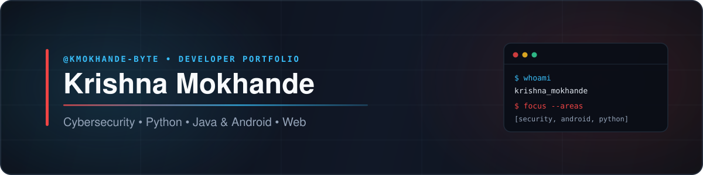

  

  
  
  

---

### About Me

Hi, I'm **Krishna Mokhande** (`@kmokhande-byte`) — a developer exploring **cybersecurity fundamentals**, **Android app development**, **Python automation**, and **web technologies**.

- Exploring security concepts, privacy-oriented tools, and defensive utility scripts
- Building mobile apps in **Java / Android** and lightweight CLI/web utilities in **Python** & **JavaScript**
- Continuously learning clean engineering practices and shipping hands-on projects

---

### Tech Stack & Tools

  
  
  
  
  
  
  
  

---

### Featured Projects

| Project | Description | Tech |
| :--- | :--- | :--- |
| [**StickerBridgeApp**](https://github.com/kmokhande-byte/StickerBridgeApp) | Android sticker pack bridge app for WhatsApp with animated WebP support | `Java` `Android` `Gradle` `Fresco` |
| [**book**](https://github.com/kmokhande-byte/book) | Python CLI tool that discovers and filters publicly available legal PDF study links | `Python` `CLI` `Stdlib` |
| [**file_Danger_Detector**](https://github.com/kmokhande-byte/file_Danger_Detector) | Lightweight JavaScript security utility for flagging potentially risky file extensions | `JavaScript` `Security` |
| [**passwordHasher**](https://github.com/kmokhande-byte/passwordHasher) | Educational JavaScript project demonstrating basic password encoding concepts | `JavaScript` `Security Learning` |
| [**ProVpn**](https://github.com/kmokhande-byte/ProVpn) | Privacy-focused VPN project concept and security architecture overview | `Privacy` `Networking` |

---

### Connect

- Explore my repositories: [github.com/kmokhande-byte](https://github.com/kmokhande-byte?tab=repositories)
- Open to collaborating on **cybersecurity learning tools**, **Python utilities**, and **Android apps**.
